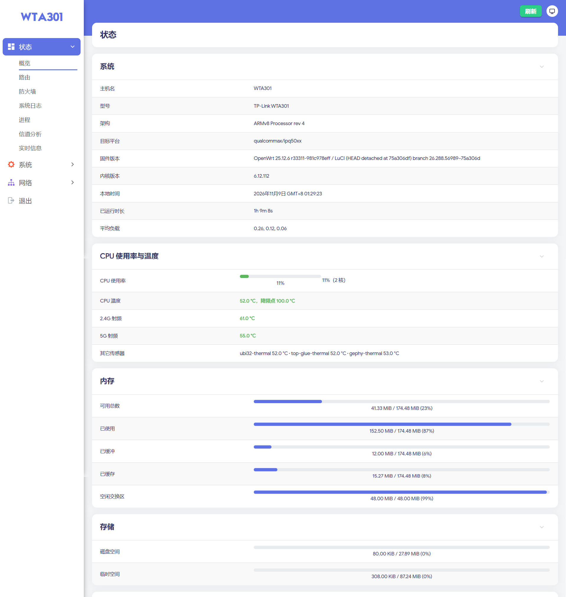

# TP-Link WTA301 OpenWrt

> ## ⚠️ 免责声明 · 先读这一段
>
> **本项目仅供技术交流与学习研究。**
>
> 1. **仅代表本人设备。** 仓库里所有结论、日志、截图、md5、分区地址，都来自
>    作者手里**这一台** WTA301（IPQ5018 / 128 MiB NAND / GD5F1GQ5REYIG）。
>    TP-Link 存在多个硬件版本、多个出厂固件版本，你的板子**可能不是同一台**，
>    同一个地址在你的板子上完全可能是别的东西。**不要假设通用。**
> 2. **刷入后果自负。** 刷 u-boot、刷固件、改分区、写 NAND 都是不可逆或
>    极难恢复的操作。**变砖、丢数据、失去保修、硬件损坏，全部由操作者自己承担**，
>    作者不承担任何责任。
> 3. **不提供任何保证。** 不保证能用、不保证稳定、不保证安全、不保证以后还能
>    救回来。文档里标「未验证」的地方就是**真的没验证**，不要当成能用。
> 4. **动手前请确认你已经具备**：① 一个能在**动手前**正常工作的 TTL 串口
>    （不是刷完之后才想起要）；② 完整读完了 [`docs/`](docs/) 里对应的阶段记录；
>    ③ 接受「这台机器可能救不回来」这个前提。
> 5. **遵循当地法律与厂商条款。** 自行破解、修改固件可能违反保修条款甚至当地
>    法规，请自行判断并承担后果。
> 6. **不要把本项目的产物当商品卖，也不要用它去刷不属于你的设备。**
>
> 继续往下读，即视为你已理解并接受以上全部内容。
>
> ---

把 **TP-Link WTA301**（Qualcomm IPQ5018 Wi-Fi 6 路由器）跑上 **OpenWrt 25.12.6** 的完整移植工程：
设备树、内核补丁、u-boot（含网页恢复界面）、固件打包、成品固件，以及每一步的实测证据。

板子是本仓库作者自己的一台机器，所有结论都在**真机**上验证过；没验证的地方在文档里
明确标为「未验证」，不写成「已完成」。



↑ 真机截图：WTA301 上跑着的 OpenWrt 25.12.6 `r33311-981c978eff`，浏览器访问 `192.168.1.1` 的 LuCI。
成品固件在 [Releases](https://github.com/HeRockOne/wta301-2512/releases)。

---

## 支持的硬件

| 项 | 规格 |
|---|---|
| SoC | Qualcomm **IPQ5018**（2× Cortex-A53 @ 1 GHz，2.4 GHz 射频内置） |
| 5 GHz | **QCN6122**（Wi-Fi 6，独立芯片） |
| 交换机 | **Realtek RTL8367S** → 4× RJ45，CPU 口 SGMII 1 Gbps |
| 内存 | 256 MiB DDR3（可用 174.5 MiB） |
| Flash | 128 MiB NAND |
| 按键 | reset（GPIO20）、WPS（GPIO17） |
| LED | 5 个（含一个 `green:wan`，但本机没有 WAN 口） |
| 串口 | 1 个（`blsp1_uart1`） |

**没有**：USB、PCIe 外设、SD/MMC。（DTS 里 `pcie0/pcie1` 注明 `disabled on purpose`。）

---

## 现在能做什么

| 能力 | 状态 | 文档 |
|---|---|---|
| 启动、有线 4 口（DHCP + 桥接） | ✅ 真机验证 | `docs/P7-WIRED-FIX-VERIFIED.md` |
| 双频 Wi-Fi（5 GHz HE80 / 2.4 GHz HT20） | ✅ 真机验证 | `docs/M12-FIRMWARE-BDF.md` |
| 中文 LuCI + Argon 主题 | ✅ | `docs/P16-CHINESE-LUCI.md` |
| 重置 / WPS 按键 | ✅ | `docs/P17-ARGON-KEYS.md` |
| overlay 断电持久化 | ✅ | `docs/P11-OVERLAY-PERSISTENCE.md` |
| **u-boot 网页刷机**（不死 u-boot + 自带 HTTP 恢复页） | ✅ | `docs/P20-UBOOT-UI.md` |
| **系统内 `sysupgrade`**（LuCI 直接刷，不用进 u-boot） | ✅ 真机验证 | `docs/P28-SYSUPGRADE-IN-OS.md` |
| LuCI 概览页 CPU / 温度面板 | ✅ | `docs/P30-THERMAL.md` |
| 性能调优（packet steering / IRQ 亲和 / NAPI budget） | ✅ 已烧进固件 | `docs/P26-PERF-TUNING.md` |
| 开箱即用（默认 SSID / 密码 / 信道） | ✅ | `docs/P25-OUT-OF-BOX.md` |
| **NSS 硬件加速** | ❌ 有意不做 | `docs/R21-CPU-LOAD-VS-STOCK-EXTERNAL-EVIDENCE.md` |
| 2.5G HSGMII | ❌ 交换芯片不支持 | `docs/R17-RTL8367S-SERDES.md` |

> **为什么 CPU 占用比原厂高**：原厂走 NSS（闭源硬件转发，947 Mbps @ 9% CPU）。
> 我们用主线的软件转发，有线 ~590 Mbps @ 80% CPU。要 NSS 就得弃 DSA、
> 换闭源 blob、内核全部脱离主线 —— 与「长期稳定家用」冲突，故不做。
> 完整对比数据见上面的 R21 文档。

---

## 固件下载

成品固件在 **Releases** 页（仓库里不存二进制，`*.bin` 已被 `.gitignore` 排除）。

每个版本给三个包，**用途完全不同，不能混刷**：

| 文件 | 大小 | 用途 |
|---|---|---|
| `wta301-op-25.12.6-<ver>.bin` | 17,170,432 B | **u-boot 网页刷机**（紧凑布局 `0x1060000`） |
| `wta301-op-25.12.6-<ver>-sysupgrade.bin` | ~13.4 MB | **系统内升级**（LuCI / `sysupgrade`） |
| `rescue/wta301-op-25.12.6-<ver>-ttl.bin` | 20,447,232 B | **串口救砖**（稀疏布局 `0x1380000`，含 head/tail 填充） |
| `wta301-uboot-p21c.bin` | 262,144 B | u-boot 槽镜像（一般不用刷，u-boot 本身已经是这个版本） |

网页包和 TTL 包的**布局不同**（紧凑 vs 稀疏），互相刷会写错偏移。看标题对号入座。

### 刷机流程

**第一次从原厂 / 别的 OpenWrt 过来 —— 必须走 u-boot 网页**：

1. 断电，按住 reset 不放，上电，等约 **40 秒**到红灯常亮（进入 u-boot failsafe）
2. 网线接到 LAN 口，电脑设 `192.168.1.2/24`，浏览器开 `http://192.168.1.1`
3. 上传网页包 → 页面会先校验再写入
4. 刷完**手动 `bootipq`**，不要放手

细节与故障处理见 `docs/USER-MANUAL.md` §3。

**之后的版本 —— 直接在 LuCI 里刷**：
「系统 → 备份/刷写固件」上传 `-sysupgrade.bin`。
配置和已装软件包**会自动保留**（overlay 在独立的 UBI 卷上，升级不碰它）。

### 回原厂

原厂固件在 B 槽（`mtd10` + `mtd11`）里原封不动保留着。
`boot_flag`（`mtd13`）= `55 aa 42 46 | 00 00 00 02`，大端 `2` = 从 A 槽启动。
把原厂 A 槽镜像 dd 回 `mtd5` + `mtd6` 即可，`boot_flag` 不用改。

---

## 仓库结构

| 目录 | 内容 |
|---|---|
| `patches/uboot/` | **u-boot kit** —— 全部 u-boot 新增代码（23 个文件，整份 overlay 不打 diff）+ 构建脚本 + 槽镜像打包器。见 `patches/uboot/README.md` |
| `patches/kernel-6.12/` | 内核补丁：UNIPHY PCS、stmmac DWMAC、gephy 时钟、dt-binding |
| `patches/mac80211/` | ath11k 低内存 DP ring 尺寸 |
| `patches/fstools/` | `fstools_overlay_name` 支持（overlay 用自定义 UBI 卷名） |
| `patches/bdf/` | Wi-Fi 板型容器 `board-2.bin` 的**生成位置**（仓库不分发，见下）。用 `tools/mk_board2_from_art.py` 从你自己的 ART 分区生成 |
| `patches/tphdr/` | TP 头模板（**122 字节**，不是 128 MB 全盘镜像）。出包时拼进固件包，字段含义见该目录 README |
| `files/` | DTS + 设备树覆盖 |
| `files-rootfs/` | rootfs overlay：`net-tune` 守护、sysctl、LuCI 温度面板、rpcd 数据源 |
| `files-base-files/` | base-files overlay：出厂无线配置、uci-defaults |
| `files-ipq50xx-upgrade/` | `platform.sh`（系统内升级的板级实现） |
| `deliver/` | 应用脚本、出包脚本、验收脚本 |
| `tools/` | 校验 / 刷写 / 串口 / 三方差异表工具 |
| `tools/getroot/` | **免拆机拿原厂 root** 的脚本（`rawtcp_gw.py`）+ 反面证据 + 失败模式。见 `tools/getroot/README.md` |
| `pin/` | 事实快照（上游 `.config`、S7 基线、板级实测数据） |
| `docs/` | 分析、风险登记、阶段记录、外部证据、复现指南。**读之前先看 `docs/README.md`**（里的路径与 IP 是取证记录，不是配置） |
| `evidence/` | 实测日志 |

**不包含**（按固定引用取）：OpenWrt 源码树（14 GB）、u-boot 源码树（133 MB）、工具链。
具体 tag / commit 见 `docs/REPRODUCE.md`。

**也不需要**：全盘镜像（128 MB）、u-boot 槽镜像、原厂固件包 ——
这三样早期是构建的硬依赖，现在都解耦了：
TP 头用 `patches/tphdr/` 里的 122 字节模板（逐字节等价，见
`docs/REPRODUCTION-VERIFICATION.md` §8.2）；u-boot 槽只影响一个可选字段，
缺了会明确降级并告诉你三种处理方式。

已验证：把仓库 clone 到**没有 `work/` 上级目录**的地方，
`make-release.sh` 与 `make-deliverable.sh` 都能 `RC=0`（§8.3）。

---

## 从源码构建

### 先做一步：生成 board-2.bin

`board-2.bin` 里装的是**逐台**射频校准数据（从 ART 分区提取），属于厂商烧进
flash 的数据，**本仓库不分发**。构建前用你自己的板子生成一次：

```bash
# 需要本机 root（不拆机、不接 TTL）：见 tools/getroot/README.md
# 板子有 python3：
scp tools/mk_board2_from_art.py root@192.168.1.1:/tmp/
ssh root@192.168.1.1 "python3 /tmp/mk_board2_from_art.py --art /dev/mtdblock2 --outdir /tmp/bdf"
scp root@192.168.1.1:/tmp/bdf/board2-wta301-*.bin patches/bdf/

# 板子没有 python3：先 dump 再本地跑
ssh root@192.168.1.1 "dd if=/dev/mtdblock2 of=/tmp/art.bin"
scp root@192.168.1.1:/tmp/art.bin .
python3 tools/mk_board2_from_art.py --art art.bin --outdir patches/bdf
```

为什么不分发、以及为什么这不影响射频性能：`THIRD-PARTY.md` §2。
细节：`patches/bdf/README.md`。`patches/bdf/*.bin` 已 gitignore，不会误入库。

### OpenWrt

```bash
git clone https://github.com/openwrt/openwrt.git
cd openwrt && git checkout 64900e756efa667774214f9c6b17c113222e01f7   # v25.12.6

# ① 装 feeds（LuCI 全部从 luci feed 来）
./scripts/feeds update -i && ./scripts/feeds install -a

# ② 铺权威 .config（母树实测的那份，不是随便 defconfig 出来的）
cp /path/to/wta301-2512/pin/ow2512-dot-config.txt .config

# ③ 铺本仓库的 overlay + 补丁（脚本会逐项校验 md5）
bash /path/to/wta301-2512/deliver/apply-to-2512.sh /path/to/openwrt

make -j$(nproc) world
make -j$(nproc) target/install
```

> ★ **①②③ 三步缺一不可，漏了都不会报错。** 两个已实测踩过的坑：
>
> | 漏了 | 后果 | 判据 |
> |---|---|---|
> | ① `feeds install -a` | `make world` **返回 0**，但少 27 个 LuCI 包（sysupgrade 13.4→12.7 MB），刷进去没 Web 界面 | ⑧ 尺寸 |
> | ② `cp pin/ow2512-dot-config.txt .config` | 同上 —— `make defconfig` 从最小集重算，LuCI 全丢 | ⑧ 尺寸 |
>
> `apply-to-2512.sh` 在 feeds 未装时会直接报错退出（不会让你编到一半才发现）。
> 编完跑 `bash deliver/verify-scratch-build.sh` 八条判据自查。

`apply-to-2512.sh` 会碰 `target/linux/qualcommax/files/`，**触发内核全量重编（约 45 分钟）**。
只改用户态时用 `deliver/apply-rootfs-only.sh`，不触发重编。

出包：

```bash
bash deliver/make-release.sh --version p31 --stage P31        # 四区 + sysupgrade
bash deliver/make-deliverable.sh p31                          # 三种成品包 + 自检
bash deliver/make-open-release.sh P31                         # 对外发布包（含网页包）
```

### u-boot

见 `patches/uboot/README.md`。要点：

```bash
UBOOT_TREE=/path/to/u-boot-2016 \
TOOLCHAIN_BIN=/path/to/toolchain/bin \
bash patches/uboot/build/build_j1.sh
```

验收：`u-boot.bin` 应为 **556,032 B**，槽镜像 262,144 B / md5 `d0ada9f7…`。

---

## 「别人 clone 下来能不能编出来」—— 已实测回答

这是开源前必须先回答的问题。结论分三个层次，每层都有实测依据：

| 问题 | 答案 | 依据 |
|---|---|---|
| **能编出结构正确的固件吗？** | **能**。**两棵完全独立的树**各编一遍（一棵 `clone --no-local` 自作者的树、一棵从 `git.openwrt.org` 全新 clone），都是 manifest **190 包逐包 diff 无输出**，内核区 / rootfs 区 / tphdr / 网页包尺寸**精确相同** | `docs/REPRODUCTION-VERIFICATION.md` §4 |
| **能按流程刷入吗？** | **能**。p30 已真机干净刷入，`check-v30.sh` **PASS=30 FAIL=0**；p31 相对 p30 只多一个 `wta301-relay`（+3,072 B squashfs），刷写路径未变 | 同上 §7 |
| **能编出 md5 完全相同的固件吗？** | **不能**，且这不是本项目缺陷 | 同上 §3 |

### 自己编完怎么判断「编对了」

```bash
bash deliver/verify-scratch-build.sh \
     --log  /path/to/build.log   \      # 必须有 WORLD_RC= / INSTALL_RC=
     --tree /path/to/openwrt     \      # apply 过的那棵树
     --rel  /path/to/rel-out            # make-release.sh 的输出
#   → OK=23  WARN=0  FAIL=0
```

它把九条判据做成可执行检查，包括：分区偏移要 **精确** `0x4880000/0x740000`、
FIT 内嵌 DTB 与 DTS 一致、rootfs 里关键文件 md5、区域尺寸、
以及**与 `pin/p31-manifest.txt` 逐包比对**。

★ 它**有意不判 md5 相同** —— squashfs 含时间戳，那个判据只会永远是红的。
判的是「结构是否正確」，这才是能判的东西。

### 三个编完才发现的静默失败（都已修，判据已覆盖）

`make world` 返回 0 **不等于**结果对。实测踩到三处：

| 漏了什么 | 后果 | 现在会被拦住 |
|---|---|---|
| `./scripts/feeds install -a` | 少 27 个 LuCI 包、没 Web 界面 | `apply-to-2512.sh` `exit 1` |
| `cp pin/ow2512-dot-config.txt .config` | 同上 | 同上（检查 `luci*` ≥ 10） |
| Argon 主题源码 | 少 2 个包，**尺寸只差 0.2%** | `apply-to-2512.sh` `exit 1`；判据 ⑨ 逐包比对 |

第三处最难发现 —— 0.2% 落在任何「合理波动」范围里。详见
`docs/REPRODUCTION-VERIFICATION.md` §4.2。

---

## ⚠️ 刷机前必须知道的三件事

1. **二级 u-boot 链接基址是 `0x49900000`，不是 `0x4a920000`。**
   链错 → 一级跳过去找不到东西 → **串口直接死**。

2. **一级 u-boot（`factory_boot`，`0x0–0x3c0000`）永不写入。**
   它是唯一的救命通道。本仓库的所有工具都不会碰它。

3. **u-boot 基座 commit 未固定。**
   `patches/uboot/README.md` §1.1 写明了这个残余风险：codelinaro 上游当时没记 commit。
   补救是本目录的 `files/` 是**整份 overlay**（改过的文件全量收录，不打 diff），
   只要基座同代（2016.01 / QSDK 12.5）就能重建出等价产物。
   跨基座版本重编不保证 md5 一致 —— 这是已知局限，不是疏漏。

---

## 已知限制

| 限制 | 说明 |
|---|---|
| 无 WAN 口 | 5 个交换口全在 `br-lan` 桥里，有意设计（原厂也只有一个桥） |
| 内存紧 | `MemTotal 174.5 MiB`，ath11k 独占 73.4 MiB = 42%。装软件包要看容量 |
| 无 `cpufreq` | IPQ5018 频率锁定，无法调频/降频省电 |
| 无 RTC | 重启后时钟倒退，判断事件先后要用 `/proc/uptime` |
| 5 GHz 峰值温度较高 | 满载打到 90 °C（芯片阈值 120 °C，`ath11k_thermal cur_state=0/100`）。给 5G 芯片加散热片有用，给 CPU 加没用（两者不在同一硅片） |
| mtd8 的 22 MiB 未启用 | 改分区表风险大于收益，保留不动。理由见 `docs/P22-STORAGE-LAYOUT.md` |

---

## 许可

本仓库的**原创部分**（脚本、文档、DTS、u-boot 新增代码、内核补丁）以 **GPL-2.0** 发布，
见 [`LICENSE`](LICENSE)。这是与 OpenWrt、u-boot、Linux 内核保持一致的选择。

仓库内含的第三方材料及其许可见 [`THIRD-PARTY.md`](THIRD-PARTY.md)。
其中 `patches/bdf/` 与 ART 校准数据的关系，务必读那一节。

GPL-2.0 第 15、16 条原文即包含免责：本程序**不提供任何担保**，包括不提供可售性
或适用于特定用途的默示担保。**因使用本程序造成的任何直接或间接损失，包括但不限于
设备变砖、数据丢失、失去保修、业务中断，作者不承担责任。**

再加上本文档开头那段：**仅供技术交流，仅代表本人这一台设备，刷入后果自负。**

---

## 致谢

- **OpenWrt** —— 整个用户态、LuCI、`ipq50xx` 子目标
- **Linux 内核** + Qualcomm 上游化工作（UNIPHY PCS、IPQ5018 DWMAC、gephy 时钟）
- **ath11k** —— 无线驱动，以及上游那套低内存 DP ring 尺寸提案
- **u-boot** 与 CodeLinaro QSDK（`NHSS.QSDK.12.5` 分支）
- **kenzok8 / jerrykuku** —— Argon 主题
- 所有在 OpenWrt 论坛、linux-arm-msm、lore.kernel.org 上留下实证记录的人 ——
  本工程大部分的「可行 / 不可行」结论，先是他们的，然后才是我们验证的
